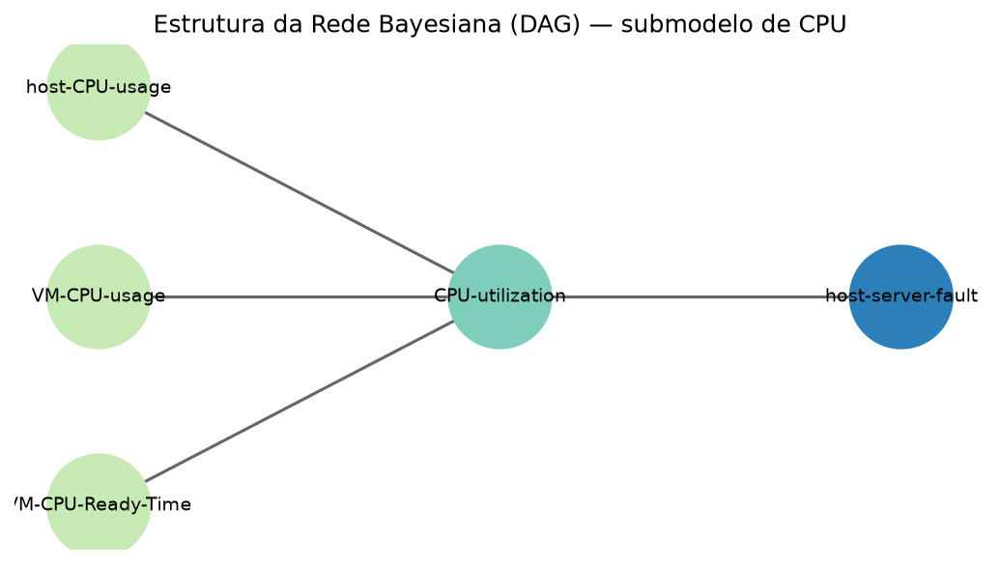
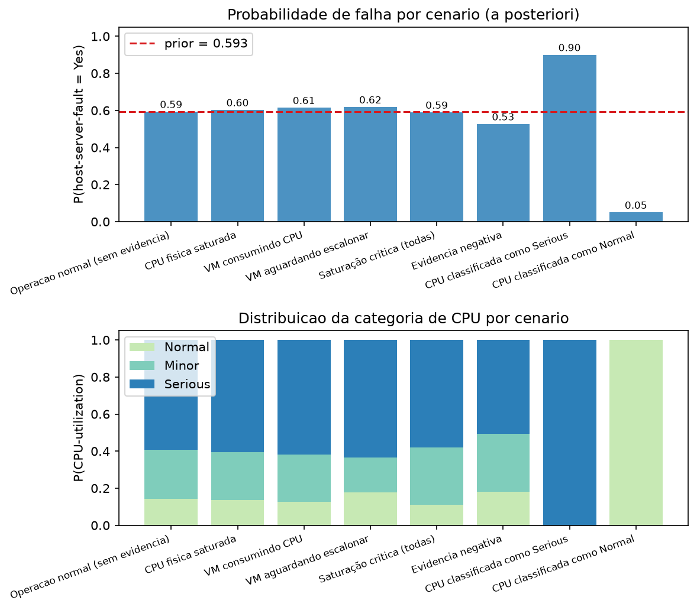
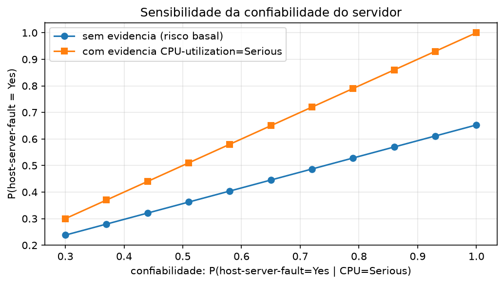
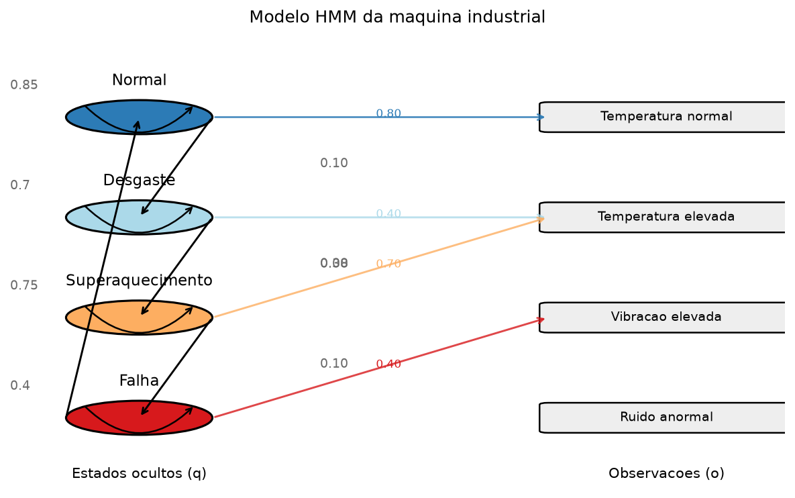
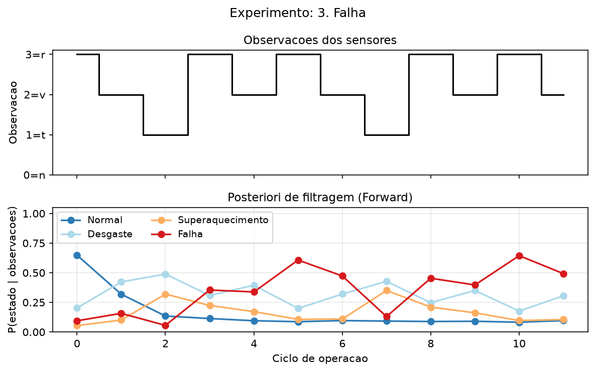
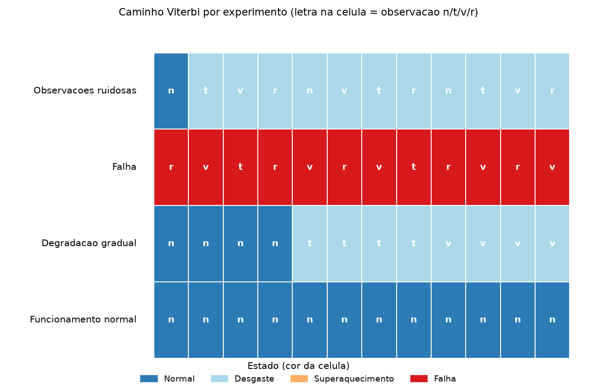
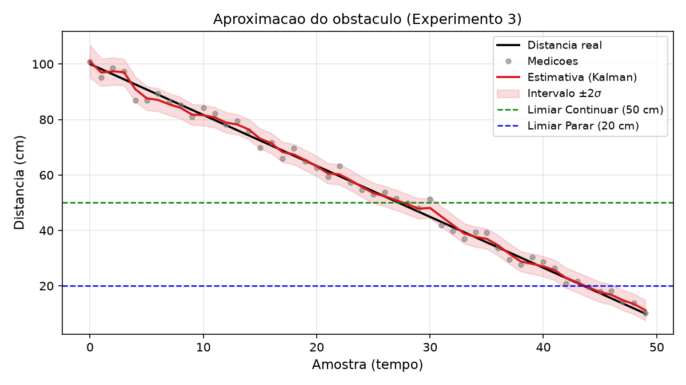
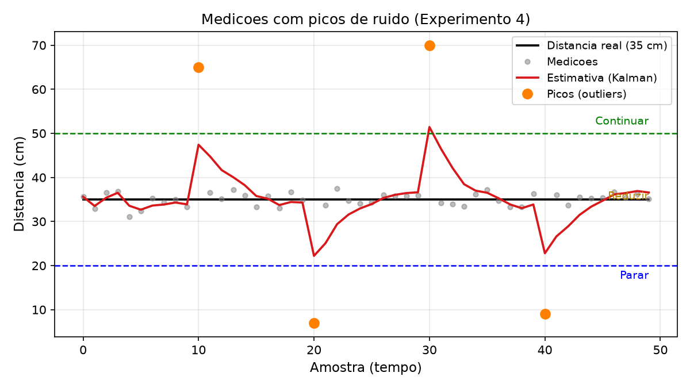
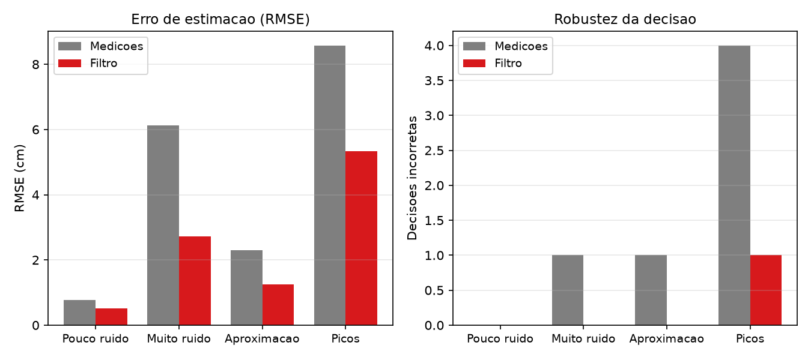

# Portfólio — Parte 3: Tratando Incerteza em Inteligência Artificial

---

| Campo | Informação |
|---|---|
| **Autor** | Gabriel Alves |
| **Matrícula** | 241025523 |
| **Disciplina** | FGA0221 – Inteligência Artificial |
| **Professor** | Fabiano Araujo Soares |
| **Turma** | T01 — 2º/2026 |
| **Data de entrega** | 05/11/2026 |

---

## Sumário

1. [Introdução](#1-introdução)
   - 1.1 [Organização do Relatório](#11-organização-do-relatório)
2. [Projetos](#2-projetos)
   - 2.1 [Projeto 1: Redes Bayesianas](#21-projeto-1-redes-bayesianas)
   - 2.2 [Projeto 2: Modelos Markovianos Ocultos (HMM)](#22-projeto-2-modelos-markovianos-ocultos-hmm)
   - 2.3 [Projeto 3: Filtros de Kalman](#23-projeto-3-filtros-de-kalman)
3. [Considerações Finais Gerais](#3-considerações-finais-gerais)
4. [Referências Bibliográficas](#referências-bibliográficas)

---

## 1 Introdução

Este relatório integra a **Parte 3 do Portfólio** da disciplina FGA0221 – Inteligência Artificial (2º/2026), conforme o Plano de Ensino do Prof. Fabiano Araujo Soares. O tema desta parte é **Tratando Incerteza**, cobrindo três técnicas probabilísticas fundamentais: Redes Bayesianas, Modelos Markovianos Ocultos (HMM) e Filtros de Kalman.

Cada um dos três projetos a seguir é acompanhado de: (i) descrição do problema, (ii) descrição detalhada do algoritmo desenvolvido, (iii) resultados com imagens e valores e (iv) considerações finais. Os arquivos Python comentados são entregues em conjunto, nomeados conforme indicado ao início de cada seção.

### 1.1 Organização do Relatório

O relatório está estruturado em três seções principais, uma por projeto:

- **Projeto 1** — Redes Bayesianas &nbsp;&nbsp;`proj1_redes_bayesianas.py`
- **Projeto 2** — Modelos Markovianos Ocultos (HMM) &nbsp;&nbsp;`proj2_hmm.py`
- **Projeto 3** — Filtros de Kalman &nbsp;&nbsp;`proj3_filtro_kalman.py`

---

## 2 Projetos

---

### 2.1 Projeto 1: Redes Bayesianas

> **Arquivo:** `proj1_redes_bayesianas.py`

#### Descrição do Problema

O projeto modela o **diagnóstico de falha de um servidor hospedeiro** (*host server*) a partir de métricas de monitoramento de CPU, com base no estudo de caso de Alkasem et al. (2017) sobre falha de inicialização em computação em nuvem. Nesse cenário, uma falha raramente é precedida por um único indicador isolado: a combinação de uso de CPU física, de consumo de CPU pelas máquinas virtuais (VMs) e do tempo em que uma VM permaneceu pronta sem ser escalonada (*VM-CPU-Ready-Time*) é que eleva o risco de degradação do serviço. O objetivo é estimar, de forma probabilística, a chance de o servidor apresentar falha a partir dessas evidências — inclusive quando parte delas está indisponível.

Uma Rede Bayesiana (RB) é adequada porque representa, de modo compacto e interpretável, as **relações de dependência condicional** entre as variáveis por meio de um grafo direcionado acíclico (DAG), permitindo atualizar as probabilidades de falha conforme novas evidências são observadas — em vez de depender de regras determinísticas de limiar (thresholds), que o artigo aponta como suscetíveis a falsos alarmes.

A estrutura adotada segue o submodelo de CPU do artigo (Figura 1), com cinco nós e três níveis:

- **Causas-raiz** (observáveis, binárias): `host-CPU-usage`, `VM-CPU-usage` e `VM-CPU-Ready-Time`, cada uma com estados *No/Yes* e independentes a priori;
- **Categoria latente** `CPU-utilization`, com estados *Normal/Minor/Serious*, que condensa as três métricas;
- **Sintoma** `host-server-fault` (*No/Yes*), que depende apenas da categoria de CPU.

#### Algoritmo Desenvolvido

A rede foi construída **do zero** em Python (sem bibliotecas de RB), usando `numpy` para os fatores, `networkx` para o desenho do DAG e `matplotlib` para os gráficos.

**Construção das CPTs.** Os parâmetros provêm do artigo: o prior `P(host-CPU-usage=Yes) = 0.88` (Tabela 9 do artigo) e a CPT de `CPU-utilization` (Tabela 10), cujas colunas seguem a ordem `[VM-CPU-Ready-Time, host-CPU-usage, VM-CPU-usage]`. Os priors de `VM-CPU-usage` (0.30) e `VM-CPU-Ready-Time` (0.35) e a CPT do nó de falha (`P(falha|Normal)=0.05`, `|Minor)=0.20`, `|Serious)=0.90`) são **hipóteses experimentais explicitadas**, derivadas da regra de decisão da Tabela 7 e ajustáveis via terminal. Como a Tabela 10 publicada tem uma coluna que soma 1.01 (arredondamento), cada coluna é renormalizada para somar 1.

**Inferência.** A probabilidade conjunta é fatorada como `P(falha, CPU, m1, m2, m3) = P(falha|CPU)·P(CPU|m1,m2,m3)·∏P(mi)`. Implementaram-se dois algoritmos exatos, validados um contra o outro:

1. **Enumeração da distribuição conjunta** — produto de todos os fatores seguido de marginalização das variáveis ocultas e normalização;
2. **Eliminação de variável (sum-product)** — condiciona os fatores na evidência e elimina cada variável oculta multiplicando os fatores que a contêm e somando sobre seus estados, evitando materializar a joint completa.

Consultas como `P(host-server-fault | evidência)` e `P(CPU-utilization | evidência)` são respondidas por ambos os métodos, cuja igualdade é conferida automaticamente a cada consulta (tolerância `1e-9`). A execução é feita por um **menu interativo** (forma principal), que permite fixar/alternar evidências nas três métricas e alterar o prior de CPU, além de flags opcionais (`--evidence`, `--prior-host-cpu`, `--nao-interativo`).

#### Resultados

A Tabela 1 resume os cenários simulados. A probabilidade de falha **a priori** (sem evidência) é `P(falha=Yes) = 0.5935`.

| Cenário | Evidência | P(falha=Yes) |
|---|---|---|
| 1. Operação normal | — | 0.5935 |
| 2. CPU física saturada | host-CPU-usage=Yes | 0.6026 |
| 3. VM consumindo CPU | VM-CPU-usage=Yes | 0.6145 |
| 4. VM aguardando escalonar | VM-CPU-Ready-Time=Yes | 0.6181 |
| 5. Saturação crítica | todas=Yes | 0.5895 |
| 6. Evidência negativa | host-CPU-usage=No | 0.5266 |
| 7. CPU classificada Serious | CPU-utilization=Serious | 0.9000 |
| 8. CPU classificada Normal | CPU-utilization=Normal | 0.0500 |

*Tabela 1 — Probabilidade de falha a posteriori por cenário.*

Dois comportamentos merecem destaque. Primeiro, o efeito das métricas individuais é **modesto** (cenários 2–5): como o artigo modela um servidor já sob investigação de falha, o prior 0.88 mantém o risco basal elevado. Segundo, a **propagação completa pela categoria latente** é decisiva: fixar `CPU-utilization=Serious` eleva `P(falha)` para 0.90, enquanto `Normal` a reduz para 0.05 — um contraste de 18× que ilustra o poder da inferência ao longo da cadeia causal.

A **inferência diagnóstica** reproduz o resultado de propagação do artigo (Seção 5, Figura 7). Dado que o servidor falhou, a causa mais provável é a CPU física:

- `P(host-CPU-usage=Yes | falha) = 0.8935` (≈ 89%, consistente com os 88% reportados no artigo);
- `P(CPU-utilization=Serious | falha) = 0.8984`;
- `P(VM-CPU-usage=Yes | falha) = 0.3106` e `P(VM-CPU-Ready-Time=Yes | falha) = 0.3645`.

Por fim, a **análise de sensibilidade** (Figura 3) varre a CPT de falha — isto é, `P(falha=Yes | CPU=Serious)` de 0.30 a 1.00 — representando servidores com diferentes níveis de confiabilidade. O risco basal cresce de forma aproximadamente linear com esse parâmetro, evidenciando que a confiabilidade do modelo depende criticamente da qualidade das probabilidades condicionais fornecidas.

#### Considerações Finais

O projeto demonstrou que uma RB permite estimar o risco de falha sob incerteza, combinando evidências parciais e respondendo tanto a consultas preditivas (evidência → falha) quanto diagnósticas (falha → causa). A principal limitação prática é a **qualidade das CPTs**: a Tabela 10 do artigo é não-monotônica (o estado *Serious* não é máximo na configuração "todas=Yes"), reflexo de probabilidades aprendidas de uma amostra pequena (40 anomalias injetadas), o que torna as variações por métrica individual discretas e, por vezes, contra-intuitivas.

Quanto à complexidade, a inferência exata (enumeração e eliminação de variável) é exponencial na *treewidth* do grafo; aqui, por se tratar de um modelo de baixa conectividade, ambas foram computadas sem custo perceptível. A eliminação de variável escala melhor que a enumeração ao evitar materializar a distribuição conjunta completa, mas ainda é exata — para redes grandes e densamente conectadas seria necessário recorrer a métodos aproximados (amostragem por MCMC ou *belief propagation* loopy). A estrutura escolhida, com uma única categoria latente e o nó de falha condicionado apenas a ela, é fiel ao artigo, porém restringe o diagnóstico a uma única família de causas (CPU).

Extensões possíveis incluem a incorporação de outras categorias de falha (memória, rede, I/O) e de um nó de decisão/utilitário (diagrama de influência, como o artigo propõe), bem como a evolução para uma **Rede Bayesiana Dinâmica** para raciocinar sobre séries temporais de métricas, em conjunto com o filtro de Kalman usado no artigo para pré-processar o ruído.

---

### 2.2 Projeto 2: Modelos Markovianos Ocultos (HMM)

> **Arquivo:** `proj2_hmm.py`

#### Descrição do Problema

O projeto consiste em estimar a **condição operacional de uma máquina industrial** a partir de sinais de sensores (temperatura, vibração e ruído). O estado real da máquina — Normal, Desgaste, Superaquecimento ou Falha — **não é diretamente observável**: um sensor de temperatura elevada, por exemplo, pode indicar superaquecimento, mas também ocorre em uma máquina apenas desgastada. O objetivo é usar um **Modelo Markoviano Oculto (HMM)** para inferir, ciclo a ciclo, a condição mais provável, combinando as observações dos sensores com a probabilidade de a máquina transitar entre estados ao longo do tempo.

O HMM é adequado porque modela, de forma explícita, um processo estocástico em que os estados são latentes e as observações são emitidas probabilisticamente a partir deles, assumindo que o estado no instante `t` depende apenas do estado em `t−1` (hipótese de Markov de 1ª ordem).

#### Algoritmo Desenvolvido

O modelo (Figura 1) tem **4 estados ocultos** (Normal, Desgaste, Superaquecimento, Falha) e **4 observações** (temperatura normal, temperatura elevada, vibração elevada, ruído anormal), com probabilidades **definidas manualmente** (sem treinamento Baum-Welch), permitindo controlar o comportamento da máquina. Os três componentes são:

- **Distribuição inicial π** = (0.80, 0.15, 0.04, 0.01): a máquina normalmente inicia saudável;
- **Matriz de transição A** (Tabela 1): `A[i,j] = P(q_t=j | q_{t−1}=i)`;
- **Matriz de emissão B** (Tabela 2): `B[i,k] = P(o_t=k | q_t=i)`. Cada estado tem uma assinatura: Normal emite temperatura normal; Desgaste e Superaquecimento emitem temperatura elevada (este com maior intensidade); Falha emite vibração/ruído.

| de \\ para | Normal | Desgaste | Superaq. | Falha |
|---|---|---|---|---|
| Normal | 0.85 | 0.10 | 0.04 | 0.01 |
| Desgaste | 0.20 | 0.70 | 0.08 | 0.02 |
| Superaquec. | 0.05 | 0.10 | 0.75 | 0.10 |
| Falha | 0.30 | 0.20 | 0.10 | 0.40 |

*Tabela 1 — Matriz de transição A (linhas = estado atual).*

| estado \\ obs | Temp. norm. | Temp. elev. | Vibração | Ruído |
|---|---|---|---|---|
| Normal | 0.80 | 0.10 | 0.07 | 0.03 |
| Desgaste | 0.30 | 0.40 | 0.25 | 0.05 |
| Superaquec. | 0.10 | 0.70 | 0.15 | 0.05 |
| Falha | 0.05 | 0.20 | 0.40 | 0.35 |

*Tabela 2 — Matriz de emissão B (linhas = estado).*

Foram implementados dois algoritmos, do zero, com NumPy:

1. **Forward (com escalonamento)** — computa `α_t(i) = P(o_1…o_t, q_t=i)` recursivamente por `α_t(j) = B[j,o_t] · Σ_i α_{t−1}(i)·A[i,j]`. O escalonamento evita *underflow*; a **log-verossimilhança** da sequência é a soma dos logaritmos dos fatores de escala, e o `α_t` normalizado fornece a posteriori de filtragem `P(q_t | o_1…o_t)`.
2. **Viterbi (em log-probabilidades)** — encontra a sequência mais provável de estados `q*` via `δ_t(j) = log B[j,o_t] + max_i (δ_{t−1}(i) + log A[i,j])`, retrocedendo ao final para reconstruir o caminho.

#### Resultados

A Tabela 3 resume os experimentos, com a log-verossimilhança de cada sequência e o caminho decodificado pelo Viterbi. A Figura 2 detalha o experimento de falha (observações no topo, posteriori de filtragem embaixo) e a Figura 3 compara o caminho Viterbi de todos os cenários.

| Experimento | log-veross. | Caminho Viterbi |
|---|---|---|
| 1. Funcionamento normal | −4.45 | Normal (estável) |
| 2. Degradação gradual | −12.49 | Normal → Desgaste |
| 3. Falha | −23.84 | Falha (estável) |
| 4. Transição progressiva | −11.89 | Normal → Superaquec. → Falha |
| 5. Observações ruidosas | −20.62 | Desgaste (ambíguo) |

*Tabela 3 — Log-verossimilhança e caminho Viterbi por experimento.*

Os resultados confirmam o comportamento esperado: a sequência de operação normal é decodificada como Normal estável (log-veross. elevada, −4.45); a elevação gradual de temperatura e vibração leva à identificação de Desgaste; os sinais de vibração/ruído intensos levam à Falha. O **experimento 4** mostra o papel da matriz de transição: com `A` mais "rígida" (alta permanência), a mesma sequência de degradação é decodificada como Desgaste (log-veross. −12.89), enquanto com `A` mais "progressiva" ela avança até Superaquecimento e Falha (log-veross. −11.89) — evidenciando que a inferência depende tanto das emissões quanto das transições. No **experimento 5**, observações inconsistentes produzem uma posteriori ambígua e log-verossimilhança baixa (−20.62), sinal de que a sequência é pouco típica do modelo.

#### Considerações Finais

O HMM mostrou-se eficaz para estimar estados não observáveis a partir de evidências sequenciais, com a vantagem de ser interpretável: cada parâmetro (π, A, B) tem significado físico direto. A principal limitação é a **hipótese de Markov de 1ª ordem**, que descarta memória além do estado imediatamente anterior — insuficiente quando a condição depende de um histórico mais longo. A inferência também é sensível à **qualidade das probabilidades** definidas manualmente e à **escolha do número de estados/observações**: um número insuficiente limita o poder discriminativo, enquanto um excessivo dificulta a interpretação. Por fim, o projeto não incluiu aprendizado de parâmetros, fixando π, A e B manualmente.

Extensões naturais incluem o algoritmo de **Baum-Welch** para estimar π, A e B a partir de dados históricos, o **Backward** (para suavização com todas as observações) e HMMs de ordem superior ou com misturas de emissões (gaussianas) para observações contínuas.

---

### 2.3 Projeto 3: Filtros de Kalman

> **Arquivo:** `proj3_filtro_kalman.py`

#### Descrição do Problema

O projeto simula um **robô com sensor de distância** (como o ultrassônico HC-SR04) que mede continuamente a distância até um obstáculo e deve decidir entre **continuar**, **reduzir a velocidade** ou **parar**. As medições do sensor são contaminadas por ruído gaussiano — por exemplo, para uma distância real de 40 cm o sensor pode indicar 38, 42, 39, 45, 36… — e, se o robô decidir diretamente sobre esses valores, um pico de ruído pode ser interpretado incorretamente como perigo (ou como segurança).

O objetivo é usar o **Filtro de Kalman** para estimar a distância real a partir das medições imprecisas, produzindo uma estimativa mais estável e permitindo decisões mais confiáveis. As variáveis de estado são a distância `d` e a sua taxa de variação `v`; a observação disponível é apenas a distância medida. Há duas fontes de incerteza: o **ruído de processo** (a velocidade real pode variar entre amostras) e o **ruído de medição** (imprecisão do sensor). O filtro é adequado porque combina, de forma ótima, a previsão de um modelo de movimento com cada nova medição, ponderando-as pelas suas respectivas incertezas.

#### Algoritmo Desenvolvido

O estado é `X = [d, v]ᵀ`. Com intervalo `dt = 1` entre amostras e **modelo de velocidade constante** (a distância avança segundo a velocidade atual), as matrizes do modelo são:

- **F** (transição) = `[[1, 1], [0, 1]]`;
- **H** (observação) = `[[1, 0]]` — o sensor mede apenas a distância;
- **R** = `[[σ_m²]]` — variância do ruído do sensor (configurável por experimento);
- **Q** = `[[0.01, 0], [0, 0.10]]` — ruído de processo: pouca incerteza na distância, maior na velocidade (que pode mudar);
- **P₀** = `[[σ_m², 0], [0, 10]]` — incerteza inicial: a distância parte com a incerteza do sensor e a velocidade, desconhecida, com incerteza grande.

O filtro alterna duas etapas. Na **Predição**, projeta-se o estado e a covariância do erro um passo adiante: `x̄ = F·x` e `P̄ = F·P·Fᵀ + Q`. Na **Atualização**, calcula-se o **ganho de Kalman** `K = P̄·Hᵀ·(H·P̄·Hᵀ + R)⁻¹`, que determina o quanto confiar na nova medição em relação à previsão, e corrige-se `x = x̄ + K·(z − H·x̄)` e `P = (I − K·H)·P̄`. O resultado é uma estimativa que suaviza as oscilações do sensor. Sobre a distância estimada, aplica-se a regra de decisão com limiares fixos: `d > 50 cm` → continuar; `20 ≤ d ≤ 50 cm` → reduzir; `d < 20 cm` → parar.

#### Resultados

A Tabela 1 resume as métricas. Em todos os cenários o filtro reduziu o RMSE em relação às medições brutas, e diminuiu ou igualou o número de decisões incorretas.

| Experimento | RMSE medidas (cm) | RMSE filtro (cm) | Decisões incorretas (medidas → filtro) |
|---|---|---|---|
| 1. Pouco ruído (σ=1) | 0.77 | 0.52 | 0 → 0 |
| 2. Muito ruído (σ=8) | 6.13 | 2.72 | 1 → 0 |
| 3. Aproximação (σ=3) | 2.30 | 1.25 | 1 → 0 |
| 4. Picos (σ=2 + outliers) | 8.58 | 5.34 | 4 → 1 |

*Tabela 1 — RMSE e robustez de decisão por experimento.*

A Figura 1 mostra o experimento de **aproximação** (distância caindo de 100 a 10 cm): a estimativa acompanha a trajetória real com suavidade, a banda de incerteza **±2σ** (extraída de `P[0,0]`) é estreita e as transições entre as zonas de decisão (linhas tracejadas em 50 e 20 cm) ocorrem no momento correto.

A Figura 2 destaca o experimento de **picos**: os quatro *outliers* empurram as medições para fora da zona correta (para "Continuar" ou "Parar"), mas a estimativa permanece próxima dos 35 cm reais, mantendo a decisão "Reduzir" na maior parte do tempo — o que reduz as decisões incorretas de 4 para 1.

A Figura 3 compara, por experimento, o RMSE e o número de decisões incorretas das medições e do filtro, evidenciando o ganho do filtro sobretudo com ruído elevado e com picos.

#### Considerações Finais

O Filtro de Kalman mostrou-se eficaz para suavizar medições ruidosas e tornar a tomada de decisão mais robusta, com a vantagem de ser computacionalmente barato e de fornecer, além da estimativa, uma medida de incerteza (a covariância `P`). Suas hipóteses, porém, são restritivas: exige **modelo de transição linear** e **ruídos gaussianos** com média zero. No experimento de picos, as hipóteses de gaussianidade são violadas pelos *outliers*, e o filtro, embora atenue o efeito, ainda é parcialmente desviado por eles (RMSE do filtro segue alto, 5.34 cm) — uma limitação conhecida do filtro clássico.

Em cenários onde a dinâmica é não linear (movimento com aceleração variável, medições não lineares), alternativas são o **Filtro de Kalman Estendido (EKF)** e o **Unscented (UKF)**, que linearizam ou propagam a distribuição por pontos sigma; para ruído não gaussiano ou múltiplas hipóteses, o **Filtro de Partículas** é mais adequado. Uma extensão simples deste projeto seria incluir a **aceleração** no vetor de estado para acompanhar melhor variações rápidas de distância.

---

## 3 Considerações Finais Gerais

As três técnicas modelam a incerteza de forma probabilística explícita, em contraste com os métodos determinísticos da Parte 2. Diferenciam-se, porém, na natureza do problema: **Redes Bayesianas** raciocinam sobre um domínio discreto e estático, estimando causas a partir de evidências (diagnóstico de falha); **HMMs** estendem isso a sequências temporais de estados ocultos discretos (monitoramento da máquina); e o **Filtro de Kalman** estima um estado contínuo que evolui no tempo sob ruído (distância do sensor). Em comum, todos ponderam evidência e conhecimento prévio, produzindo distribuições de probabilidade em vez de respostas pontuais — o que os torna interpretáveis e úteis quando há dados incompletos ou ruidosos. Sua principal limitação é a dependência de probabilidades e modelos bem especificados, ponto em que o aprendizado de máquina moderno pode complementá-los, estimando esses parâmetros a partir de dados.

---

## Referências Bibliográficas

RUSSELL, S.; NORVIG, P. **Artificial Intelligence: A Modern Approach**. 4. ed. Pearson, 2022.

BISHOP, C. M. **Pattern Recognition and Machine Learning**. Springer, 2006.

WELCH, G.; BISHOP, G. **An Introduction to the Kalman Filter**. University of North Carolina at Chapel Hill, 2006. Disponível em: https://www.cs.unc.edu/~welch/media/pdf/kalman_intro.pdf.

ALKASEM, A.; LIU, H.; SHAFIQ, M.; ZUO, D. A new theoretical approach: a model construct for fault troubleshooting in cloud computing. **Mobile Information Systems**, v. 2017, Article ID 9038634, p. 1-16, 2017. DOI: https://doi.org/10.1155/2017/9038634.